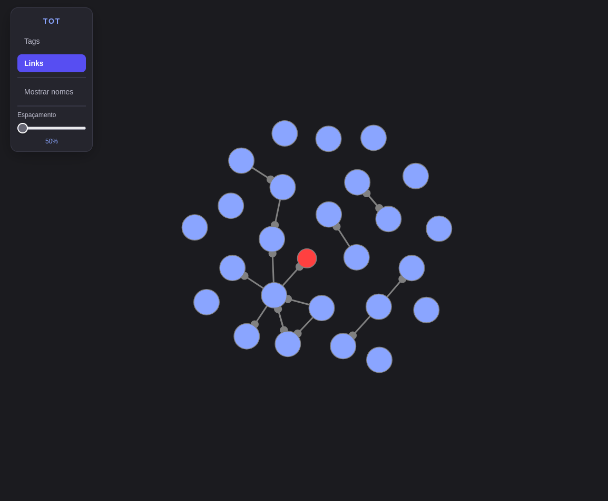
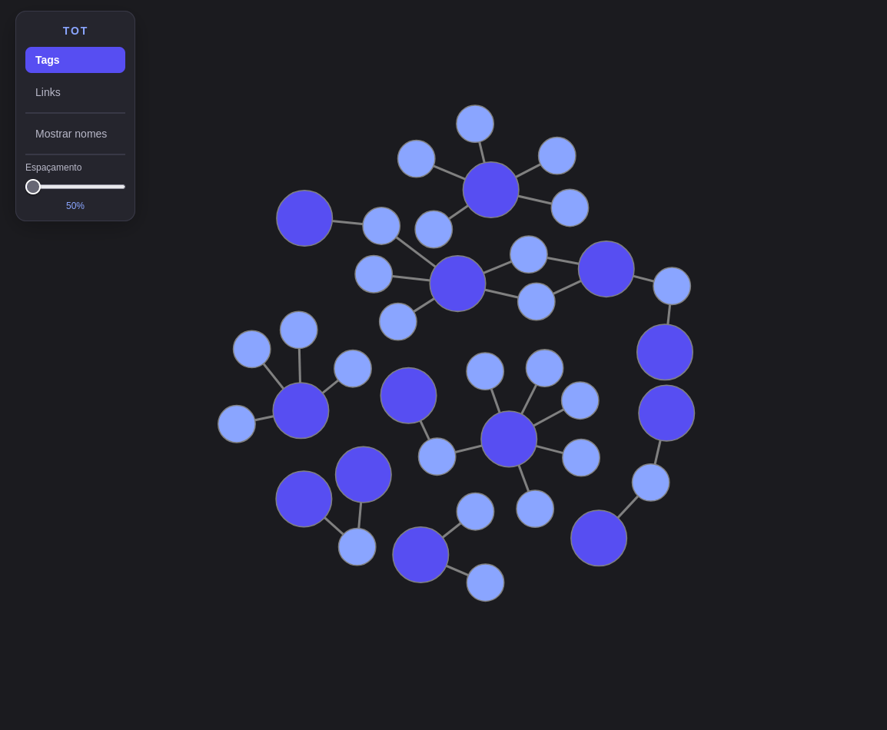

# TOT - Gerador de grafos CLI

## Descrição

O tot é um aplicativo CLI que transforma um vault de arquivos Markdown (uma pasta com o sufixo `.tot`) em grafos interativos, de **tags** e de **links** entre as notas. Um daemon fica de olho no vault e regenera o grafo sozinho sempre que algo muda, e o próprio CLI responde consultas rápidas (busca de tag, busca de nota e métricas) sem você sair do terminal.

> Funciona em Linux (usa socket Unix e `.desktop` pro autostart). Requer Python 3.14+.

---

## Instalação

### UV

```bash
# clona o repo na pasta que preferir
git clone https://github.com/rry-monteiro/tot.git
cd tot
uv tool install .
```

Isso instala o comando `tot` no seu PATH. Pra atualizar depois de mexer no código: `uv tool install . --force`.

---

## Uso

### Sintaxe esperada

O tot não pede pra você aprender sintaxe nova, só usa o que já existe no Markdown ;)

**Tags**: uma lista `tags: [...]` na nota (o jeito normal é no frontmatter):

```markdown
---
tags: [rust, linux, hardware]
---
```

**Links**: link Markdown padrão pra outro arquivo `.md`, com caminho relativo à nota:

```markdown
Veja também [minha outra nota](subpasta/outra.md)
```

### Vault

```
Documentos/
└── meu_vault.tot/          ← pasta com sufixo .tot
    ├── nota_a.md
    ├── nota_b.md
    └── subpasta/
        └── nota_c.md
```

O tot procura uma pasta com sufixo `.tot` dentro de `~/Documentos`. Garanta que **exista exatamente uma**: se não tiver nenhuma ou tiver mais de uma, ele para com erro.

### Primeiros passos

```bash
tot system daemon      # sobe o daemon (gera o grafo e fica observando o vault)
```

Com o daemon rodando, abra no navegador o arquivo:

```
~/Documentos/tot.graph.html
```

Ele é regenerado automaticamente a cada mudança no vault (basta recarregar a página). Pra o daemon subir junto com a sessão:

```bash
tot system install     # cria ~/.config/autostart/tot.desktop
tot system uninstall   # remove
```

> O `install` precisa ser rodado pelo comando instalado (`uv tool install`), não pelo `uv run`, porque o `.desktop` grava o caminho do executável.

### Comandos

| comando | descrição |
|-|-|
| `tot system daemon` | sobe o daemon: gera o grafo e acompanha o vault |
| `tot system install` | instala o daemon no autostart |
| `tot system uninstall` | remove o daemon do autostart |
| `tot -t TAG` | lista as notas que têm a tag (aceita com ou sem `@`) |
| `tot -n NOTA` | mostra tags, links de saída e backlinks de uma nota |
| `tot -m` | métricas gerais do vault |

As flags de consulta (`-t`, `-n`, `-m`) podem ser combinadas entre si, mas não com `system`.

**`-n`** busca por pedaço do nome, sem diferenciar maiúscula de minúscula. Se mais de uma nota bater, ele lista as candidatas pra você refinar; se o nome for exato, ele ganha.

**`-m`** mostra:

- total de notas, tags e links
- top 5 notas mais linkadas (backlinks)
- top 5 tags mais usadas
- notas não linkadas (sem links de saída e sem backlinks)
- links quebrados (apontam pra nota que não existe)

```
------------------------------
notas existentes:    25
tags existentes:     11
links feitos:        15

top notas mais linkadas:
4    learning-python/00-preparacao-do-ambiente.md
...
------------------------------
```

*(exemplo ilustrativo)*

### O grafo

O `tot.graph.html` tem os dois grafos num arquivo só, e você troca entre eles pelo menu lateral.

|  | Tags | Links |
|-|-|-|
| mostra | a qual tag cada nota está atrelada | quais notas chamam quais |
| nós | tags (grandes) → notas (menores) | só notas |
| setas | sem direção | uma bolinha cinza marca o destino do link |

Cores: **roxo** = tag, **azul** = nota, **vermelho** = link quebrado (nota que não existe).

Interações: arrastar nós, zoom (20% a 500%), ocultar/mostrar nomes e um slider de espaçamento (50% a 200%) que ajusta a distância das conexões e a repulsão dos nós.

> O d3 é carregado por CDN, então o HTML precisa de internet pra abrir.

---

## Capturas de tela

### Gráfico de links


### Gráfico de tags


---

## Como funciona por baixo

```
 vault (.md) ──watchdog──▶ daemon ──▶ índice em memória ──▶ tot.graph.html
                              │
                              └── socket Unix ◀── tot -t / -n / -m
```

1. **Índice em memória**: o daemon faz um scan completo do vault na inicialização (em threads) e guarda tudo num dicionário `{caminho_relativo: {tags, links}}`. Depois disso ele nunca mais relê o vault inteiro: cada evento atualiza só a entrada afetada (`update`, `delete`, `move` e as versões de pasta).
2. **Watchdog + debounce**: salvar um arquivo dispara vários eventos seguidos (`opened`, `modified`, `closed`...). Os eventos são agrupados numa janela de 1 segundo e, dentro dela, só a última operação de cada caminho é executada, então o arquivo não é reparseado várias vezes. Criação, remoção e renomeio de arquivos e de pastas são tratados.
3. **Regex leve**: tags e links são extraídos com padrões pré-compilados, sem parser Markdown pesado. Links são resolvidos a partir da pasta da nota e guardados como caminho relativo ao vault, então os ids do grafo são esses caminhos.
4. **Socket Unix**: o daemon serve o índice inteiro em JSON num socket (`tot.sock`, na pasta de runtime do usuário). Os comandos `-t`, `-n` e `-m` só pedem esse JSON e filtram. Se o daemon estiver desligado, o CLI avisa e faz um scan na hora, então tudo continua funcionando, só um pouco mais lento.
5. **Geração do HTML**: `vault_index.build_js()` monta nós e arestas dos dois grafos e o resultado é injetado no template `d3.html` (no marcador `/*INSERT_DATA*/`). Nenhum HTML é montado do zero.
6. **Física**: d3-force pra simulação e canvas 2D pro desenho. Cada grafo tem a própria simulação (só a do grafo ativo roda), com repulsão entre nós, mola nas arestas, colisão e uma leve atração pro centro.

### Limitações atuais

- Mover ou renomear uma nota atualiza o índice, mas **não reescreve** os links que apontam pra ela dentro dos outros `.md`, então esses links passam a aparecer como quebrados.
- Só um vault por vez.
- O HTML depende do d3 via CDN.

---

## Próximos ajustes

- [x] Daemon que acompanha o vault (created, modified, deleted, moved, inclusive pastas)
- [x] Consultas pelo CLI: `-t`, `-n`, `-m`
- [x] Grafo próprio com d3-force + canvas, no lugar do vis-network (física individual por nó)
- [x] Métricas básicas (totais, tops, notas não linkadas, links quebrados)
- [ ] Métricas extras: porcentagem de uso de tags, quantidade de arquivos por pasta, o máximo de informação possível
- [ ] Visualização da nota com clique duplo no grafo, pra dar uma olhada rápida sem editor extra (renderizar direto no navegador)
- [ ] Reescrever os links nos `.md` quando uma nota ou pasta for movida
- [ ] Testar com vaults gigantes (milhares de notas)

---

## Sobre

### A ideia

A ideia de criar o tot surgiu do [Obsidian](https://obsidian.md/). A ideia inicial era fazer um gráfico só de frases que se conectam por chaves (usando a sintaxe `[[arquivo]]` do Obsidian) pra estudo, mas acabei percebendo que papel e caneta me ajudariam mais nisso e resolvi esquecer (depois de pronto). Depois de um tempo comecei a me interessar mais pelo pyvis e percebi que podia sair algo muito bom de lá, então comecei outra vez.

### Thoth

[Tote](https://pt.wikipedia.org/wiki/Tote) é um deus egípcio da lua, do conhecimento, da **sabedoria, da escrita**, da música e da magia. Acho importante que as pessoas gostem de escrever e estudar, acumular e aplicar conhecimento. Um gráfico de tags e links, mesmo que simples, incentiva (pelo menos a mim) a voltar a estudar e ver onde seus estudos e suas anotações se esbarram. Ter algo mais visual e palpável das suas anotações é, sem dúvida, uma das melhores formas (mais uma vez, pra mim) de estudar e realmente sentir que está aprendendo.

